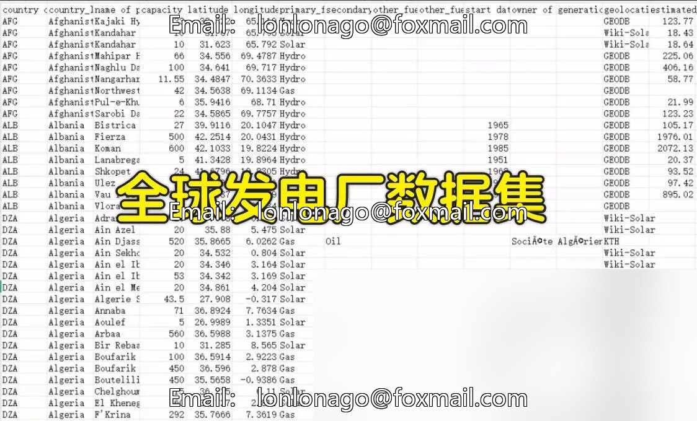

# Global power generation dataset

## Body

Global power generation factory dataset

Contains 35,000 power plant data.
Metrics: location, capacity, power generation data and owner...

web-based shipment, can be directly photographed and shipped.

The dataset covers global power generation plants, including location, capacity, generation data and owner; it contains 35,000 power generation plant records.

<!-- AI_ENRICHED -->

## Images

## Payment

Here is a pay link on Stripe ( https://buy.stripe.com/3cs8yP7sY87d0vu9AB ). Please contact me lonlonago@foxmail.com after funding $89, and I will send you a complete data files , thank you!

